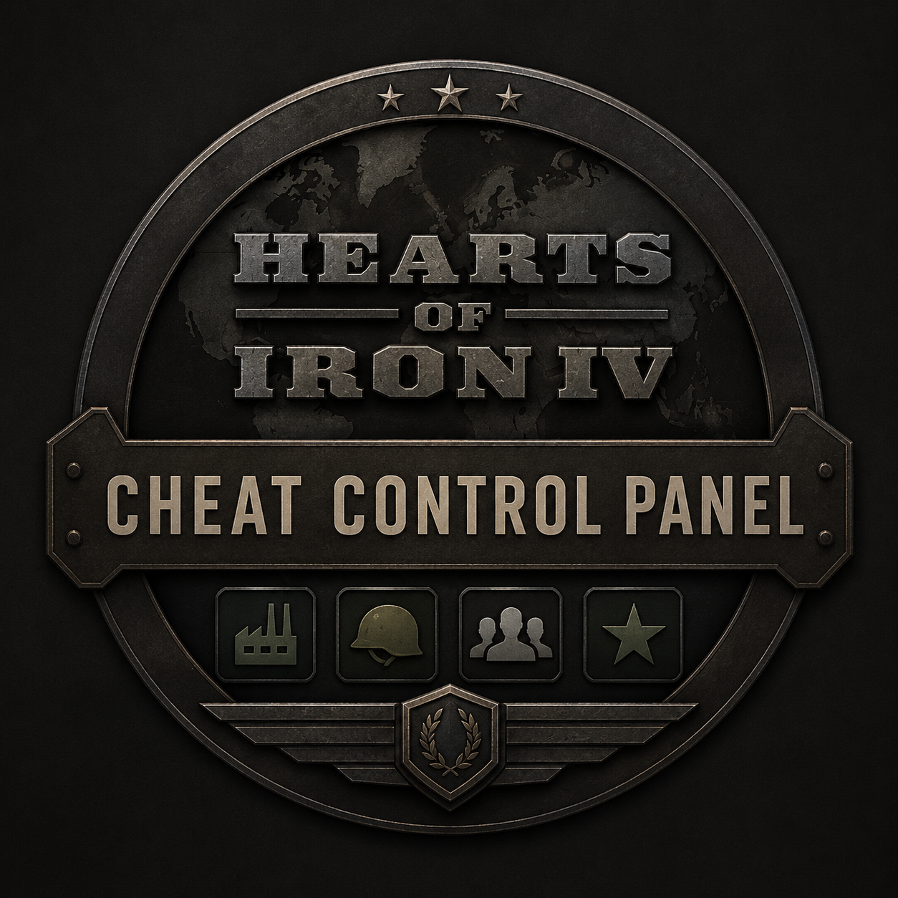

<p align="center">
  
</p>

<h1 align="center">Hearts of Iron IV — Cheat Control Panel</h1>

<p align="center">
  A categorised, tooltip-driven in-game control panel that replaces console typing.
  <br>
  <strong>Hearts of Iron IV 1.19 · MIT licensed · singleplayer</strong>
</p>

<p align="center">
  <a href="#english">English</a> ·
  <a href="#türkçe">Türkçe</a> ·
  <a href="#deutsch">Deutsch</a> ·
  <a href="#français">Français</a> ·
  <a href="#русский">Русский</a> ·
  <a href="#nederlands">Nederlands</a>
</p>

---

# English

## Overview

Hearts of Iron IV's console is powerful and unpleasant. It expects you to memorise
identifiers like `infantry_equipment_3`, offers no discovery, no validation and no undo.

The Cheat Control Panel turns those actions into a real interface:

```
Console:  add_equipment 1000 infantry_equipment_3
Panel:    Equipment → Infantry → Infantry Equipment III → ADD
```

It is an **additive** mod. It overrides no vanilla file — a release check enforces
that — and every identifier it defines is prefixed `ccp_`, so it sits alongside
other mods rather than fighting them.

## Opening the panel

Default hotkey: **`Insert`**. There is also a logo button below the top bar.

Plain `F8` is not the default because vanilla already binds it to a map mode, so
it would switch the map mode every time you opened the panel. You can change the
hotkey to `F8`, `F11`, `F12` or `Ctrl+F8` in the panel's **Settings**; the choice
is stored in your save.

## Sections

| Section | What it does |
|---|---|
| **Dashboard** | Live country summary: political power, command power, manpower, army/navy/air experience, stability, factories |
| **Resources** | Political power, command power, manpower and all three experience pools, with scaled presets and a custom amount |
| **Equipment** | Every addable variant in your installation, by category, with a live stockpile count, ADD, LATEST, and add-the-whole-category. Items you have not researched are disabled and say which technology is missing |
| **Research** | Every technology by research folder: one at a time, a whole category, or everything in the game |
| **Countries** | Annex with troop transfer, puppet, declare war, white peace, play as, or mark a country as the target other sections act on |
| **States** | Take a state, or take only its ownership or only its control; hand it or just its control to your target; add and remove cores and claims; force compliance, wipe out resistance — from the list or by clicking the map |
| **Nation** | Stability, war support, research slots, fuel, CIC funds, world tension, legitimacy, instant research bonuses, free doctrines, default occupation law |
| **Politics** | Ruling party and popularity for each ideology, civil war, autonomy |
| **Construction** | Eleven building types at several levels each, built instantly across every owned state — forts, coastal forts and supply hubs placed in the right provinces — railways from your capital to every state at four levels, shared building slots and off-map factories that cannot be bombed |
| **Resources (raw)** | All seven raw resources added to every state you own |
| **Military** | Nuclear bombs, division spawning in your capital or in a state you picked, disband everything, and the three experience pools |
| **Commanders** | Skill, attack, defence, planning and logistics for every general and admiral |
| **Diplomacy** | Opinion, intelligence, war goals, truces, factions, collaboration, guarantees, release, independence and deleting the target's army — all aimed at your target country |
| **History** | The last ten actions the panel applied, each repeatable |
| **Settings** | Hotkey, confirmation prompts, diplomacy rules, AI goodwill, compatibility and language notes |

**Every action offers several amounts, not one.** A card carries four or five buttons —
`+1 / +5 / +10 / +20` — so **76 actions become 238 choices**, alongside 11 state actions
and 5 country actions. The Equipment and Research lists add **145 equipment variants**
and **328 technologies** read from your own installation.

Sections appear only when they do something. Nothing in the panel is a placeholder.

## Languages

The panel ships in **English, German, French and Russian**, and follows the game's
own language setting. Every string it owns is translated; equipment and technology
names come from the game itself.

**Turkish and Dutch were dropped in 3.1.1.** Hearts of Iron IV loads exactly ten
localisation folders, listed in the game's own `localisation/languages.yml`, and
neither is among them. They used to travel as an overlay written into the `english`
folder, which worked until an upload was made while the overlay was applied: every
English subscriber got Turkish menus. There is no way to offer those languages that
the engine keeps separate from English, so the panel no longer offers them.

## Requirements

- Hearts of Iron IV **1.19.x** (developed against 1.19.2)
- No DLC required. DLC-specific content appears only if you own the relevant DLC.
- Python 3.10+ and Pillow, for the build tooling only — not to play the mod.

## Installation

**Steam Workshop** — [subscribe here](https://steamcommunity.com/sharedfiles/filedetails/?id=3790687445), then enable the mod in your Paradox Launcher playset.

**From source**

```bash
python tools/build_assets.py       # draw the interface plates and sprite definitions
python tools/build_interface.py    # generate the .gui files, scripts, strings and descriptor
python tools/generate_data.py      # derive equipment and technology from your installation
python tools/validate_mod.py       # release checklist
python tools/install_local.py      # copy into the game's mod directory
python tools/enable_local_mod.py   # register it in the launcher playset (launcher closed)
```

If the launcher shows the mod but the game starts without it, check that a playset
is actually active — an inactive playset makes the launcher start the game with no
mods at all. `enable_local_mod.py` fixes that and backs the launcher database up first.

## Compatibility

- **Singleplayer.** Country switching, annexation and state transfers can desync a
  multiplayer game. The engine gives script no way to detect a multiplayer session
  (`is_ironman` exists, `is_multiplayer` does not), so the panel cannot hide those
  actions automatically and says so instead of gating on a check that never fires.
- **Ironman.** The panel opens on a notice page and no section can be opened, because an
  Ironman save cannot be rolled back. This is intended. Close it with CLOSE, Esc or the hotkey.
- **Millennium Dawn and other total conversions: not compatible.** Millennium Dawn replaces
  `common/scripted_effects`, `common/scripted_triggers` and `common/scripted_localisation`,
  which removes every action the panel performs while its interface stays on screen.
- **Ironman and achievements.** Running any mod disables achievements. No Ironman
  compatibility is claimed.
- **Other mods.** No vanilla file is overridden and every identifier is namespaced.
  Total conversions that replace the interface wholesale are untested.

## Known limitations

These are engine limits, verified against the shipped game files, not oversights.

| Limitation | Consequence |
|---|---|
| Scripted GUIs cannot read text input | Custom amounts use a digit pad; browsing uses categories and pages rather than typing a search |
| Console commands cannot be invoked from script | Anything with no native equivalent — fog of war, AI acceptance — is absent rather than present and broken |
| No state snapshot API | There is no undo. Destructive actions require confirmation instead |
| Equipment and technology cannot be enumerated at runtime | Their lists are derived from your game files when the mod is built |
| No keybind remapping API | The hotkey is chosen from a fixed set rather than freely bound |
| `complete_national_focus` needs a specific focus token, and focus trees cannot be walked at runtime | There is no national focus section |
| Doctrines are a separate system since 1.19 | `set_technology` does not reach them, so Research does not list them; Nation grants them free instead, through `add_doctrine_cost_reduction` |
| `add_equipment_to_stockpile` refuses ships and railway guns | They are built as units, so they are not listed |
| `instanttraining`, `fow`, `yesman`, `allowtraits`, `freefocuses` are console switches with no scripted equivalent | Absent. Where a native effect gives the same outcome — instant construction, diplomatic rules — the panel uses that instead |
| Equipment display names differ per language | There is no A-Z filter: filing rows under an English initial would be wrong in the other three. Categories, paging and the locked-item marking cover the same need |

## How it is built

Nothing under `mod/` is written by hand. `tools/ccp/` holds the registries — the
design grid, the sections, the actions, the strings — and the build scripts emit
the `.gui` files, the scripted GUI, the effects, the scripted localisation, the
localisation files and the descriptor from them. Positions are computed from one
grid rather than typed twice, and a button cannot exist without an effect behind
it, a name in every language and a destination in the navigation.

Equipment and technology are parsed from your own installation, so the lists are
real game data rather than a hand-maintained copy that drifts out of date.

`tools/validate_mod.py` runs the release checklist — nineteen checks. Alongside the
obvious ones (descriptor validity, brace balance, sprite and effect references,
vanilla overrides, Workshop payload cleanliness) several exist because a specific
bug shipped once and must not return:

| Check | The failure it reproduces |
|---|---|
| effect vocabulary | A misspelled effect name fails silently in game. Every lowercase name the scripts assign to is checked against the game's own documentation |
| gui property grammar | `iconType` has no `size`. The parser abandons the rest of the file at the first unsupported property, so one line deleted a whole panel |
| variable comparisons | `check_variable` shorthand parses `=`, `>` and `<` only. A `>=` took the enclosing effect down with it |
| variable reads | A variable belongs to the scope that set it, so a bare `var:name` reads nothing once an effect has stepped into another country or a state — with no line in `error.log` |
| translations differ | A row still holding the English text passes a parity check while showing English in game |

## License

MIT — see [LICENSE](LICENSE).

## Credits

Created by [X1NPAR1](https://github.com/X1NPAR1).

Hearts of Iron IV is a trademark of Paradox Interactive AB. This is an unofficial,
fan-made modification, not affiliated with or endorsed by Paradox Interactive. No
assets from other mods are used.

---

# Türkçe

## Genel bakış

Hearts of Iron IV'ün konsolu güçlü ama kullanışsızdır. `infantry_equipment_3` gibi
tanımlayıcıları ezberlemenizi bekler; keşfetme, doğrulama ve geri alma sunmaz.

Hile Kontrol Paneli bu işlemleri gerçek bir arayüze dönüştürür:

```
Konsol:  add_equipment 1000 infantry_equipment_3
Panel:   Teçhizat → Piyade → Piyade Teçhizatı III → EKLE
```

Bu **eklemeli** bir moddur. Hiçbir orijinal dosyanın üzerine yazmaz — bunu bir yayın
kontrolü zorunlu kılar — ve tanımladığı her ad `ccp_` ön ekini taşır, böylece diğer
modlarla çakışmak yerine yan yana çalışır.

## Paneli açmak

Varsayılan kısayol: **`Insert`**. Ayrıca üst çubuğun altında bir logo düğmesi vardır.

Düz `F8` varsayılan değildir, çünkü oyun onu zaten bir harita moduna bağlar; paneli her
açtığınızda harita modu değişirdi. Kısayolu panelin **Ayarlar** bölümünden `F8`, `F11`,
`F12` veya `Ctrl+F8` yapabilirsiniz; seçim kaydınızda saklanır.

## Bölümler

| Bölüm | Ne yapar |
|---|---|
| **Panel** | Ülkenizin canlı özeti: siyasi güç, komuta gücü, insan gücü, kara/deniz/hava tecrübesi, istikrar, fabrikalar |
| **Kaynaklar** | Siyasi güç, komuta gücü, insan gücü ve üç tecrübe havuzu; hazır kademeler ve serbest miktar |
| **Teçhizat** | Kurulumunuzdaki eklenebilir tüm varyantlar, kategorilere ayrılmış, canlı stok sayısıyla; EKLE, EN YENİ ve kategorinin tamamını ekle. Araştırmadığınız teçhizatın düğmesi kapalıdır ve hangi teknolojinin eksik olduğunu yazar |
| **Araştırma** | Tüm teknolojiler, araştırma klasörlerine göre: tek tek, klasörün tamamı veya oyundaki her şey |
| **Ülkeler** | Askerleriyle birlikte ilhak, kuklalaştırma, savaş ilanı, beyaz barış, o ülke olarak oynama; ya da bir ülkeyi diğer bölümlerin üzerinde çalışacağı hedef olarak işaretleme |
| **Eyaletler** | Bir eyaleti tamamen alın, ya da yalnızca sahipliğini veya yalnızca kontrolünü alın; hedefinize eyaletin tamamını ya da sadece kontrolünü verin; core ve hak talebi ekleyip kaldırın; uyumu zorlayın, direnişi sıfırlayın — listeden ya da haritaya tıklayarak |
| **Ulus** | İstikrar, savaş desteği, araştırma yuvası, yakıt, CIC fonu, dünya gerginliği, meşruiyet, anında araştırma bonusu, ücretsiz doktrinler, varsayılan işgal yasası |
| **Siyaset** | Yönetici parti ve her ideoloji için popülerlik, iç savaş, özerklik |
| **İnşaat** | On bir bina türü, her biri birkaç seviyede, sahip olduğunuz her eyalette anında — kaleler, kıyı kaleleri ve ikmal merkezleri doğru illere kurulur — başkentten her eyalete dört seviyede demiryolu, paylaşımlı bina yuvaları ve bombalanamayan harita dışı fabrikalar |
| **Ham kaynaklar** | Yedi ham kaynağın tamamı, sahip olduğunuz her eyalete |
| **Ordu** | Nükleer bomba, başkentte ya da seçtiğiniz eyalette tümen üretimi, tüm birlikleri dağıtma ve üç tecrübe havuzu |
| **Komutanlar** | Her general ve amiral için beceri, saldırı, savunma, planlama ve lojistik |
| **Diplomasi** | Görüş, istihbarat, savaş hedefi, ateşkes, hizipler, iş birliği, garanti, serbest bırakma, bağımsızlık ve hedefin ordusunu silme — hepsi hedef ülkenize yönelik |
| **Geçmiş** | Panelin uyguladığı son on işlem, hepsi tekrarlanabilir |
| **Ayarlar** | Kısayol tuşu, onay pencereleri, diplomasi kuralları, yapay zekâ iyi niyeti, uyumluluk ve dil notları |

**Her eylem tek bir miktar değil, birkaç miktar sunar.** Her kartta dört ya da beş düğme
vardır — `+1 / +5 / +10 / +20` — böylece **76 eylem 238 seçeneğe** dönüşür; ayrıca 11
eyalet eylemi ve 5 ülke eylemi vardır. Teçhizat ve Araştırma listeleri de kendi
kurulumunuzdan okunan **145 teçhizat varyantı** ve **328 teknoloji** ekler.

Bölümler yalnızca bir iş yapıyorlarsa görünür. Panelde hiçbir şey süs değildir.

## Diller

Panel **İngilizce, Almanca, Fransızca ve Rusça** dillerinde gelir ve oyunun kendi dil
ayarını izler. Panelin sahip olduğu her metin çevrilidir; teçhizat ve teknoloji adları
oyunun kendisinden gelir.

**Türkçe ve Felemenkçe 3.1.1'de kaldırıldı.** Hearts of Iron IV tam olarak on
yerelleştirme klasörü yükler — oyunun kendi `localisation/languages.yml` dosyasında
listelidir — ve ikisi de aralarında değildir. Eskiden `english` klasörünün üzerine
yazılan bir kaplama olarak geliyorlardı; ta ki kaplama uygulanmışken bir yükleme
yapılana kadar: İngilizce oynayan herkese Türkçe menüler gitti. Bu dilleri motorun
İngilizceden ayrı tutacağı bir yol yok, bu yüzden panel artık onları sunmuyor.

## Gereksinimler

- Hearts of Iron IV **1.19.x** (1.19.2 üzerinde geliştirildi)
- DLC gerekmez. DLC'ye özgü içerik yalnızca ilgili DLC'ye sahipseniz görünür.
- Python 3.10+ ve Pillow — yalnızca derleme araçları için, modu oynamak için değil.

## Kurulum

**Steam Atölyesi** — [buradan abone olun](https://steamcommunity.com/sharedfiles/filedetails/?id=3790687445), ardından modu Paradox Launcher oyun setinizde etkinleştirin.

**Kaynaktan**

```bash
python tools/build_assets.py       # arayüz plakalarını ve sprite tanımlarını çiz
python tools/build_interface.py    # .gui dosyalarını, betikleri, metinleri ve descriptor'ı üret
python tools/generate_data.py      # teçhizat ve teknolojiyi kurulumunuzdan türet
python tools/validate_mod.py       # yayın kontrol listesi
python tools/install_local.py      # oyunun mod dizinine kopyala
python tools/enable_local_mod.py   # launcher oyun setine kaydet (launcher kapalıyken)
```

Launcher modu gösteriyor ama oyun onsuz açılıyorsa, gerçekten etkin bir oyun seti olup
olmadığına bakın — etkin olmayan bir oyun seti, launcher'ın oyunu hiç modsuz başlatmasına
yol açar. `enable_local_mod.py` bunu düzeltir ve önce launcher veritabanını yedekler.

## Uyumluluk

- **Tek oyunculu.** Ülke değiştirme, ilhak ve eyalet devri çok oyunculu bir oyunun
  senkronunu bozabilir. Motor, betiğe çok oyunculu oturumu algılamanın hiçbir yolunu vermez
  (`is_ironman` vardır, `is_multiplayer` yoktur); bu yüzden panel bu eylemleri kendiliğinden
  gizleyemez ve hiç çalışmayacak bir kontrole dayanmak yerine bunu açıkça yazar.
- **Ironman.** Panel bir uyarı sayfasında açılır ve hiçbir bölüm açılamaz, çünkü Ironman
  kaydı geri alınamaz. Bu bilinçli. KAPAT, Esc ya da kısayol tuşuyla kapatılır.
- **Millennium Dawn ve diğer total conversion'lar: uyumsuz.** Millennium Dawn
  `common/scripted_effects`, `common/scripted_triggers` ve `common/scripted_localisation`
  dizinlerini değiştirir; arayüz ekranda kalır ama panelin yaptığı her eylem silinir.
- **Ironman ve başarımlar.** Herhangi bir mod açıkken başarımlar kapanır. Ironman
  uyumluluğu iddia edilmez.
- **Diğer modlar.** Hiçbir orijinal dosya değiştirilmez ve her tanımlayıcı ön eklidir.
  Arayüzü baştan aşağı değiştiren toplam dönüşüm modları test edilmemiştir.

## Bilinen sınırlar

Bunlar gözden kaçmış eksikler değil, oyunun gönderdiği dosyalar üzerinde doğrulanmış motor
sınırlarıdır.

| Sınır | Sonucu |
|---|---|
| Betikli arayüzler metin girişi okuyamaz | Serbest miktarlar rakam tuş takımıyla girilir; gezinme, arama yazmak yerine kategori ve sayfayla yapılır |
| Konsol komutları betikten çağrılamaz | Yerel karşılığı olmayan her şey — savaş sisi, yapay zekâ kabulü — bozuk hâlde bulunmak yerine hiç yoktur |
| Durum anlık görüntüsü API'si yok | Geri alma yoktur. Yıkıcı işlemler bunun yerine onay ister |
| Teçhizat ve teknoloji çalışma anında listelenemez | Listeleri, mod derlenirken oyun dosyalarınızdan türetilir |
| Tuş atama API'si yok | Kısayol, serbestçe bağlanmak yerine sabit bir kümeden seçilir |
| `complete_national_focus` belirli bir odak kimliği ister, odak ağaçları da çalışma anında gezilemez | Ulusal odak bölümü yoktur |
| Doktrinler 1.19'dan beri ayrı bir sistemdir | `set_technology` onlara ulaşmaz, bu yüzden Araştırma onları listelemez; Ulus bölümü bunun yerine `add_doctrine_cost_reduction` ile onları ücretsiz yapar |
| `add_equipment_to_stockpile` gemileri ve demiryolu toplarını reddeder | Bunlar birlik olarak üretilir, bu yüzden listelenmezler |
| `instanttraining`, `fow`, `yesman`, `allowtraits`, `freefocuses` yerel karşılığı olmayan konsol anahtarlarıdır | Yoklar. Aynı sonucu veren yerel bir efekt varsa — anında inşaat, diplomasi kuralları — panel onu kullanır |
| Teçhizat adları dile göre değişir | A-Z filtresi yoktur: satırları İngilizce baş harfe göre sıralamak diğer üç dilde yanlış olurdu. Kategoriler, sayfalama ve kilitli öğe işareti aynı ihtiyacı karşılar |

## Nasıl derleniyor

`mod/` altındaki hiçbir şey elle yazılmaz. `tools/ccp/` kayıt tablolarını tutar — tasarım
ızgarası, bölümler, eylemler, metinler — ve derleme betikleri `.gui` dosyalarını, betikli
arayüzü, efektleri, betikli yerelleştirmeyi, yerelleştirme dosyalarını ve descriptor'ı
bunlardan üretir. Konumlar iki kez yazılmak yerine tek bir ızgaradan hesaplanır; bir düğme,
arkasında bir efekt, her dilde bir ad ve gezinmede bir hedef olmadan var olamaz.

Teçhizat ve teknoloji kendi kurulumunuzdan ayrıştırılır; yani listeler, zamanla eskiyen elle
tutulmuş bir kopya değil, gerçek oyun verisidir.

`tools/validate_mod.py` yayın kontrol listesini çalıştırır — **on dokuz kontrol**. Bariz
olanların (descriptor geçerliliği, parantez dengesi, sprite ve efekt referansları, orijinal
dosya değişikliği, Atölye paketi temizliği) yanında bazıları, bir hata bir kez yayına çıktığı
ve bir daha çıkmaması gerektiği için vardır:

| Kontrol | Yeniden ürettiği hata |
|---|---|
| efekt sözlüğü | Yanlış yazılmış bir efekt adı oyunda sessizce başarısız olur. Betiklerin atadığı her küçük harfli ad, oyunun kendi dokümanına karşı denetlenir |
| arayüz dilbilgisi | `iconType`'ın `size` özelliği yoktur. Ayrıştırıcı, desteklenmeyen ilk özellikte dosyanın geri kalanını bırakır; yani tek satır koca bir paneli silmişti |
| değişken karşılaştırmaları | `check_variable` kısayolu yalnızca `=`, `>` ve `<` tanır. Bir `>=`, içinde bulunduğu efekti de beraberinde götürmüştü |
| değişken okumaları | Bir değişken onu yazan kapsama aittir; efekt başka bir ülkeye veya eyalete girdikten sonra düz `var:ad` hiçbir şey okumaz — üstelik `error.log`'a tek satır bile düşmeden |
| çeviri farklılığı | İngilizce metni hâlâ taşıyan bir satır, eşlik kontrolünü geçer ama oyunda İngilizce görünür |

## Lisans

MIT — bkz. [LICENSE](LICENSE).

## Katkı

[X1NPAR1](https://github.com/X1NPAR1) tarafından yapıldı.

Hearts of Iron IV, Paradox Interactive AB'nin tescilli markasıdır. Bu, Paradox Interactive
ile bağlantısı olmayan ve onun onayını taşımayan, resmî olmayan bir hayran modudur. Başka
modlardan hiçbir dosya kullanılmamıştır.

---

# Deutsch

## Überblick

Die Konsole von Hearts of Iron IV ist mächtig und unangenehm. Sie erwartet, dass Sie
Bezeichner wie `infantry_equipment_3` auswendig können, und bietet weder Auffindbarkeit
noch Prüfung noch ein Rückgängig.

Das Cheat-Kontrollpanel macht aus diesen Aktionen eine echte Oberfläche:

```
Konsole:  add_equipment 1000 infantry_equipment_3
Panel:    Ausrüstung → Infanterie → Infanterieausrüstung III → HINZUFÜGEN
```

Es ist ein **additiver** Mod. Er überschreibt keine Originaldatei — eine Release-Prüfung
erzwingt das — und jeder Bezeichner, den er definiert, trägt das Präfix `ccp_`. So läuft
er neben anderen Mods, statt mit ihnen zu streiten.

## Das Panel öffnen

Standardtaste: **`Einfg`**. Zusätzlich gibt es eine Logo-Schaltfläche unter der oberen Leiste.

Ein einfaches `F8` ist nicht die Vorgabe, weil das Spiel es bereits auf einen Kartenmodus
legt; jedes Öffnen des Panels würde den Kartenmodus umschalten. In den **Einstellungen**
des Panels lässt sich die Taste auf `F8`, `F11`, `F12` oder `Strg+F8` ändern; die Wahl wird
im Spielstand gespeichert.

## Bereiche

| Bereich | Was er tut |
|---|---|
| **Übersicht** | Laufende Zusammenfassung: politische Macht, Kommandomacht, Menschenreserven, Heer-/Marine-/Lufterfahrung, Stabilität, Fabriken |
| **Ressourcen** | Politische Macht, Kommandomacht, Menschenreserven und alle drei Erfahrungsspeicher, mit gestuften Voreinstellungen und einem freien Betrag |
| **Ausrüstung** | Jede hinzufügbare Variante Ihrer Installation, nach Kategorie, mit Lagerbestand, HINZUFÜGEN, NEUESTE und ganze Kategorie. Nicht erforschte Ausrüstung ist deaktiviert und nennt die fehlende Technologie |
| **Forschung** | Jede Technologie nach Forschungsordner: einzeln, eine ganze Kategorie oder alles im Spiel |
| **Länder** | Annektieren samt Truppenübernahme, zum Marionettenstaat machen, Krieg erklären, Weißfrieden, als dieses Land weiterspielen, oder ein Land als Ziel markieren, auf das andere Bereiche wirken |
| **Staaten** | Einen Staat ganz nehmen, oder nur seinen Besitz beziehungsweise nur seine Kontrolle; ihn oder nur seine Kontrolle an Ihr Ziel abgeben; Kerngebiete und Ansprüche setzen und entfernen; Kollaboration erzwingen, Widerstand tilgen — aus der Liste oder per Klick auf die Karte |
| **Nation** | Stabilität, Kriegsunterstützung, Forschungsplätze, Treibstoff, CIC-Mittel, Weltspannung, Legitimität, sofortige Forschungsboni, kostenlose Doktrinen, Standard-Besatzungsgesetz |
| **Politik** | Regierungspartei und Popularität je Ideologie, Bürgerkrieg, Autonomie |
| **Bau** | Elf Gebäudearten in mehreren Stufen, sofort in jedem Ihrer Staaten — Festungen, Küstenfestungen und Versorgungsknoten in den richtigen Provinzen — Eisenbahnen von der Hauptstadt zu jedem Staat in vier Stufen, gemeinsame Baufelder und Fabriken außerhalb der Karte, die nicht bombardiert werden können |
| **Rohstoffe** | Alle sieben Rohstoffe in jedem Ihrer Staaten |
| **Militär** | Atombomben, Divisionen in der Hauptstadt oder in einem gewählten Staat aufstellen, alles auflösen und die drei Erfahrungsspeicher |
| **Kommandeure** | Fähigkeit, Angriff, Verteidigung, Planung und Logistik für jeden General und Admiral |
| **Diplomatie** | Meinung, Aufklärung, Kriegsziele, Waffenstillstände, Fraktionen, Kollaboration, Garantien, Freilassung, Unabhängigkeit und das Löschen der Armee des Ziels — alles auf Ihr Zielland gerichtet |
| **Verlauf** | Die letzten zehn Aktionen des Panels, jede wiederholbar |
| **Einstellungen** | Tastenkürzel, Bestätigungen, Diplomatieregeln, KI-Wohlwollen, Hinweise zu Kompatibilität und Sprache |

**Jede Aktion bietet mehrere Beträge, nicht einen.** Eine Karte trägt vier oder fünf
Schaltflächen — `+1 / +5 / +10 / +20` — so werden aus **76 Aktionen 238 Möglichkeiten**,
dazu 11 Staaten- und 5 Länderaktionen. Ausrüstung und Forschung bringen weitere
**145 Ausrüstungsvarianten** und **328 Technologien**, gelesen aus Ihrer eigenen Installation.

Bereiche erscheinen nur, wenn sie etwas tun. Nichts im Panel ist ein Platzhalter.

## Sprachen

Das Panel erscheint auf **Englisch, Deutsch, Französisch und Russisch** und folgt der
Spracheinstellung des Spiels. Jeder Text, der ihm gehört, ist übersetzt; Namen von
Ausrüstung und Technologie stammen aus dem Spiel selbst.

**Türkisch und Niederländisch sind mit 3.1.1 entfallen.** Hearts of Iron IV lädt genau
zehn Lokalisierungsordner, aufgeführt in der spieleigenen `localisation/languages.yml`,
und keiner von beiden ist darunter. Sie reisten früher als Overlay im `english`-Ordner
mit -- bis ein Upload erfolgte, während das Overlay lag: Alle englischen Abonnenten
bekamen türkische Menüs. Es gibt keinen Weg, diese Sprachen anzubieten, den die Engine
von Englisch trennt, also bietet das Panel sie nicht mehr an.

## Voraussetzungen

- Hearts of Iron IV **1.19.x** (entwickelt gegen 1.19.2)
- Kein DLC nötig. DLC-spezifische Inhalte erscheinen nur, wenn Sie das jeweilige DLC besitzen.
- Python 3.10+ und Pillow, nur für die Build-Werkzeuge — nicht zum Spielen des Mods.

## Installation

**Steam Workshop** — [hier abonnieren](https://steamcommunity.com/sharedfiles/filedetails/?id=3790687445), dann den Mod in Ihrem Paradox-Launcher-Playset aktivieren.

**Aus dem Quellcode**

```bash
python tools/build_assets.py       # Oberflächenplatten und Sprite-Definitionen zeichnen
python tools/build_interface.py    # .gui-Dateien, Skripte, Texte und Descriptor erzeugen
python tools/generate_data.py      # Ausrüstung und Technologie aus Ihrer Installation ableiten
python tools/validate_mod.py       # Release-Checkliste
python tools/install_local.py      # in das Mod-Verzeichnis des Spiels kopieren
python tools/enable_local_mod.py   # im Launcher-Playset eintragen (Launcher geschlossen)
```

Zeigt der Launcher den Mod an, das Spiel startet aber ohne ihn, prüfen Sie, ob wirklich ein
Playset aktiv ist — ein inaktives Playset lässt den Launcher das Spiel ganz ohne Mods starten.
`enable_local_mod.py` behebt das und sichert zuvor die Launcher-Datenbank.

## Kompatibilität

- **Einzelspieler.** Länderwechsel, Annexionen und Staatsübergaben können ein
  Mehrspielerspiel desynchronisieren. Die Engine gibt dem Skript keine Möglichkeit, eine
  Mehrspielersitzung zu erkennen (`is_ironman` existiert, `is_multiplayer` nicht), daher kann
  das Panel diese Aktionen nicht automatisch ausblenden und sagt es stattdessen offen, statt
  sich auf eine Prüfung zu verlassen, die nie auslöst.
- **Ironman.** Das Panel öffnet auf einer Hinweisseite und kein Bereich lässt sich öffnen, weil
  ein Ironman-Spielstand nicht zurückzusetzen ist. Das ist beabsichtigt. Schließen mit
  SCHLIESSEN, Esc oder der Taste.
- **Millennium Dawn und andere Totalkonversionen: nicht kompatibel.** Millennium Dawn ersetzt
  `common/scripted_effects`, `common/scripted_triggers` und `common/scripted_localisation`;
  die Oberfläche bleibt sichtbar, aber jede Aktion des Panels entfällt.
- **Ironman und Errungenschaften.** Jeder aktive Mod deaktiviert Errungenschaften. Eine
  Ironman-Kompatibilität wird nicht behauptet.
- **Andere Mods.** Keine Originaldatei wird überschrieben und jeder Bezeichner hat ein
  Präfix. Totalkonversionen, die die Oberfläche vollständig ersetzen, sind ungetestet.

## Bekannte Grenzen

Das sind Grenzen der Engine, geprüft an den mitgelieferten Spieldateien, keine Versäumnisse.

| Grenze | Folge |
|---|---|
| Skript-Oberflächen können keine Texteingabe lesen | Freie Beträge über ein Ziffernfeld; Navigation über Kategorien und Seiten statt einer getippten Suche |
| Konsolenbefehle sind aus dem Skript nicht aufrufbar | Alles ohne native Entsprechung — Nebel des Krieges, KI-Zustimmung — fehlt, statt kaputt vorhanden zu sein |
| Keine API für Zustandssicherungen | Es gibt kein Rückgängig. Zerstörerische Aktionen verlangen stattdessen eine Bestätigung |
| Ausrüstung und Technologie sind zur Laufzeit nicht aufzählbar | Ihre Listen werden beim Bauen des Mods aus Ihren Spieldateien abgeleitet |
| Keine API zum Neubelegen von Tasten | Das Tastenkürzel wird aus einer festen Auswahl gewählt statt frei gebunden |
| `complete_national_focus` braucht ein konkretes Fokus-Token, und Fokusbäume sind zur Laufzeit nicht begehbar | Es gibt keinen Fokus-Bereich |
| Doktrinen sind seit 1.19 ein eigenes System | `set_technology` erreicht sie nicht, deshalb listet Forschung sie nicht; der Bereich Nation macht sie stattdessen über `add_doctrine_cost_reduction` kostenlos |
| `add_equipment_to_stockpile` verweigert Schiffe und Eisenbahngeschütze | Sie werden als Einheiten gebaut und daher nicht gelistet |
| `instanttraining`, `fow`, `yesman`, `allowtraits`, `freefocuses` sind Konsolenschalter ohne Skript-Entsprechung | Nicht vorhanden. Wo ein nativer Effekt dasselbe bewirkt — Sofortbau, Diplomatieregeln — nutzt das Panel diesen |
| Anzeigenamen von Ausrüstung unterscheiden sich je Sprache | Es gibt keinen A-Z-Filter: eine Einordnung nach englischem Anfangsbuchstaben wäre in den anderen drei Sprachen falsch. Kategorien, Seiten und die Markierung gesperrter Einträge decken dasselbe Bedürfnis ab |

## Wie es gebaut wird

Nichts unter `mod/` ist von Hand geschrieben. `tools/ccp/` hält die Registraturen — das
Gestaltungsraster, die Bereiche, die Aktionen, die Texte — und die Build-Skripte erzeugen
daraus die `.gui`-Dateien, die Skript-Oberfläche, die Effekte, die Skript-Lokalisierung, die
Lokalisierungsdateien und den Descriptor. Positionen werden aus einem Raster berechnet statt
zweimal getippt, und eine Schaltfläche kann nicht existieren ohne einen Effekt dahinter,
einen Namen in jeder Sprache und ein Ziel in der Navigation.

Ausrüstung und Technologie werden aus Ihrer eigenen Installation gelesen, die Listen sind
also echte Spieldaten statt einer handgepflegten Kopie, die veraltet.

`tools/validate_mod.py` führt die Release-Checkliste aus — **neunzehn Prüfungen**. Neben den
naheliegenden (Descriptor-Gültigkeit, Klammerbilanz, Sprite- und Effektverweise, Überschreiben
von Originaldateien, Sauberkeit des Workshop-Pakets) gibt es einige nur, weil ein bestimmter
Fehler einmal ausgeliefert wurde und nicht zurückkehren darf:

| Prüfung | Der Fehler, den sie nachstellt |
|---|---|
| Effekt-Vokabular | Ein falsch geschriebener Effektname scheitert im Spiel lautlos. Jeder kleingeschriebene Name, dem die Skripte zuweisen, wird gegen die spieleigene Dokumentation geprüft |
| GUI-Grammatik | `iconType` hat kein `size`. Der Parser bricht bei der ersten nicht unterstützten Eigenschaft den Rest der Datei ab, eine Zeile löschte so ein ganzes Panel |
| Variablenvergleiche | Die Kurzform von `check_variable` liest nur `=`, `>` und `<`. Ein `>=` riss den umgebenden Effekt mit sich |
| Variablenzugriffe | Eine Variable gehört dem Scope, der sie gesetzt hat; ein blankes `var:name` liest nichts mehr, sobald ein Effekt in ein anderes Land oder einen Staat gewechselt ist — und zwar ohne eine Zeile in `error.log` |
| Übersetzungsunterschied | Eine Zeile, die noch den englischen Text trägt, besteht die Paritätsprüfung und zeigt im Spiel dennoch Englisch |

## Lizenz

MIT — siehe [LICENSE](LICENSE).

## Danksagung

Erstellt von [X1NPAR1](https://github.com/X1NPAR1).

Hearts of Iron IV ist eine Marke von Paradox Interactive AB. Dies ist eine inoffizielle, von
Fans erstellte Modifikation, die weder mit Paradox Interactive verbunden ist noch von ihr
unterstützt wird. Es werden keine Inhalte aus anderen Mods verwendet.

---

# Français

## Aperçu

La console de Hearts of Iron IV est puissante et désagréable. Elle attend que vous reteniez
des identifiants comme `infantry_equipment_3` et n offre ni découverte, ni validation, ni
annulation.

Le Cheat Control Panel transforme ces actions en une véritable interface :

```
Console :  add_equipment 1000 infantry_equipment_3
Panneau :  Équipement → Infanterie → Équipement d infanterie III → AJOUTER
```

C est un mod **additif**. Il ne remplace aucun fichier d origine — une vérification de
publication l impose — et chaque identifiant qu il définit porte le préfixe `ccp_`, si bien
qu il cohabite avec les autres mods au lieu de les gêner.

## Ouvrir le panneau

Raccourci par défaut : **`Inser`**. Un bouton logo se trouve aussi sous la barre supérieure.

`F8` seul n est pas la valeur par défaut, car le jeu l attribue déjà à un mode de carte :
chaque ouverture du panneau changerait le mode de carte. Dans les **Réglages** du panneau,
la touche se change en `F8`, `F11`, `F12` ou `Ctrl+F8` ; le choix est conservé dans la sauvegarde.

## Sections

| Section | Ce qu elle fait |
|---|---|
| **Tableau de bord** | Résumé en direct : pouvoir politique, pouvoir de commandement, main-d oeuvre, expérience terre/mer/air, stabilité, usines |
| **Ressources** | Pouvoir politique, pouvoir de commandement, main-d oeuvre et les trois réserves d expérience, avec des paliers et un montant libre |
| **Équipement** | Chaque variante ajoutable de votre installation, par catégorie, avec le stock en direct, AJOUTER, DERNIÈRE et toute la catégorie. Ce que vous n avez pas recherché est désactivé et indique la technologie manquante |
| **Recherche** | Chaque technologie par dossier de recherche : à l unité, une catégorie entière, ou tout le jeu |
| **Pays** | Annexer avec transfert des troupes, vassaliser, déclarer la guerre, paix blanche, reprendre ce pays, ou marquer un pays comme cible des autres sections |
| **États** | Prendre un État entièrement, ou seulement sa propriété ou seulement son contrôle ; le céder, ou n en céder que le contrôle, à votre cible ; ajouter et retirer territoires nationaux et revendications ; imposer la conformité, effacer la résistance — depuis la liste ou en cliquant sur la carte |
| **Nation** | Stabilité, soutien à la guerre, cases de recherche, carburant, fonds CIC, tension mondiale, légitimité, bonus de recherche instantanés, doctrines gratuites, loi d occupation par défaut |
| **Politique** | Parti au pouvoir et popularité par idéologie, guerre civile, autonomie |
| **Construction** | Onze types de bâtiments à plusieurs niveaux, construits instantanément dans chacun de vos États — forts, forts côtiers et nœuds de ravitaillement dans les bonnes provinces — voies ferrées de la capitale vers chaque État sur quatre niveaux, cases partagées et usines hors carte que rien ne peut bombarder |
| **Ressources brutes** | Les sept ressources brutes dans chacun de vos États |
| **Militaire** | Bombes nucléaires, création de divisions dans la capitale ou dans un État choisi, dissolution générale, et les trois réserves d expérience |
| **Commandants** | Compétence, attaque, défense, planification et logistique pour chaque général et amiral |
| **Diplomatie** | Opinion, renseignement, casus belli, trêves, factions, collaboration, garanties, libération, indépendance et suppression de l armée de la cible — tout visant votre pays cible |
| **Historique** | Les dix dernières actions appliquées par le panneau, toutes rejouables |
| **Réglages** | Raccourci, confirmations, règles diplomatiques, bienveillance de l IA, notes de compatibilité et de langue |

**Chaque action propose plusieurs montants, pas un seul.** Une carte porte quatre ou cinq
boutons — `+1 / +5 / +10 / +20` — si bien que **76 actions deviennent 238 choix**, auxquels
s ajoutent 11 actions d État et 5 actions de pays. Les listes Équipement et Recherche
apportent **145 variantes d équipement** et **328 technologies** lues dans votre propre installation.

Une section n apparaît que si elle fait quelque chose. Rien dans le panneau n est un espace réservé.

## Langues

Le panneau existe en **anglais, allemand, français et russe** et suit le réglage de
langue du jeu. Chaque texte qui lui appartient est traduit ; les noms d équipement et de
technologie viennent du jeu lui-même.

**Le turc et le néerlandais ont été retirés en 3.1.1.** Hearts of Iron IV charge
exactement dix dossiers de localisation, énumérés dans son `localisation/languages.yml`,
et aucun des deux n y figure. Ils voyageaient en surcouche écrite dans le dossier
`english` -- jusqu à un envoi effectué alors que la surcouche était en place : tous les
abonnés anglophones ont eu des menus en turc. Aucun moyen d offrir ces langues sans que
le moteur les confonde avec l anglais, donc le panneau ne les propose plus.

## Prérequis

- Hearts of Iron IV **1.19.x** (développé sur 1.19.2)
- Aucun DLC requis. Le contenu propre à un DLC n apparaît que si vous le possédez.
- Python 3.10+ et Pillow, uniquement pour les outils de compilation — pas pour jouer.

## Installation

**Steam Workshop** — [s abonner ici](https://steamcommunity.com/sharedfiles/filedetails/?id=3790687445), puis activer le mod dans votre playset du Paradox Launcher.

**Depuis les sources**

```bash
python tools/build_assets.py       # dessiner les plaques d interface et les définitions de sprites
python tools/build_interface.py    # générer les .gui, les scripts, les textes et le descripteur
python tools/generate_data.py      # dériver équipement et technologies de votre installation
python tools/validate_mod.py       # liste de contrôle de publication
python tools/install_local.py      # copier dans le dossier de mods du jeu
python tools/enable_local_mod.py   # l inscrire dans le playset du launcher (launcher fermé)
```

Si le launcher affiche le mod mais que le jeu démarre sans lui, vérifiez qu un playset est
bien actif — un playset inactif fait démarrer le jeu sans aucun mod. `enable_local_mod.py`
corrige cela et sauvegarde d abord la base du launcher.

## Compatibilité

- **Solo.** Changer de pays, annexer et transférer des États peut désynchroniser une partie
  multijoueur. Le moteur ne donne au script aucun moyen de détecter une session multijoueur
  (`is_ironman` existe, `is_multiplayer` non) : le panneau ne peut donc pas masquer ces
  actions automatiquement et le dit clairement plutôt que de s appuyer sur un test qui ne se
  déclenche jamais.
- **Ironman.** Le panneau s ouvre sur une page d avertissement et aucune section ne s ouvre,
  car une sauvegarde Ironman ne se rembobine pas. C est voulu. Fermez avec FERMER, Échap ou
  le raccourci.
- **Millennium Dawn et autres conversions totales : incompatibles.** Millennium Dawn remplace
  `common/scripted_effects`, `common/scripted_triggers` et `common/scripted_localisation` ;
  l interface reste affichée mais chaque action du panneau disparaît.
- **Ironman et succès.** Tout mod actif désactive les succès. Aucune compatibilité Ironman
  n est revendiquée.
- **Autres mods.** Aucun fichier d origine n est remplacé et chaque identifiant est préfixé.
  Les conversions totales qui remplacent entièrement l interface ne sont pas testées.

## Limites connues

Ce sont des limites du moteur, vérifiées sur les fichiers livrés avec le jeu, pas des oublis.

| Limite | Conséquence |
|---|---|
| Les interfaces scriptées ne peuvent pas lire une saisie | Les montants libres passent par un pavé numérique ; la navigation utilise catégories et pages plutôt qu une recherche tapée |
| Les commandes console ne sont pas appelables depuis un script | Tout ce qui n a pas d équivalent natif — brouillard de guerre, acceptation de l IA — est absent plutôt que présent et cassé |
| Pas d API de capture d état | Il n y a pas d annulation. Les actions destructrices exigent une confirmation à la place |
| Équipement et technologies ne sont pas énumérables à l exécution | Leurs listes sont dérivées de vos fichiers de jeu à la compilation du mod |
| Pas d API de réattribution des touches | Le raccourci se choisit dans un ensemble fixe plutôt que librement |
| `complete_national_focus` exige un focus précis, et les arbres de focus ne sont pas parcourables à l exécution | Il n y a pas de section focus national |
| Les doctrines sont un système à part depuis 1.19 | `set_technology` ne les atteint pas, donc Recherche ne les liste pas ; Nation les rend gratuites via `add_doctrine_cost_reduction` |
| `add_equipment_to_stockpile` refuse les navires et les canons ferroviaires | Ils se construisent comme unités, ils ne sont donc pas listés |
| `instanttraining`, `fow`, `yesman`, `allowtraits`, `freefocuses` sont des bascules console sans équivalent scripté | Absents. Là où un effet natif donne le même résultat — construction instantanée, règles diplomatiques — le panneau l utilise |
| Les noms d équipement changent selon la langue | Pas de filtre A-Z : classer les lignes sous une initiale anglaise serait faux dans les trois autres langues. Catégories, pagination et marquage des éléments verrouillés couvrent le même besoin |

## Comment c est construit

Rien sous `mod/` n est écrit à la main. `tools/ccp/` contient les registres — la grille de
mise en page, les sections, les actions, les textes — et les scripts de compilation en
émettent les fichiers `.gui`, l interface scriptée, les effets, la localisation scriptée, les
fichiers de localisation et le descripteur. Les positions sont calculées à partir d une seule
grille plutôt que saisies deux fois, et un bouton ne peut exister sans un effet derrière lui,
un nom dans chaque langue et une destination dans la navigation.

Équipement et technologies sont analysés depuis votre propre installation : les listes sont
de vraies données de jeu plutôt qu une copie maintenue à la main qui se périme.

`tools/validate_mod.py` déroule la liste de contrôle — **dix-neuf vérifications**. À côté des
évidentes (validité du descripteur, équilibre des accolades, références de sprites et
d effets, remplacement de fichiers d origine, propreté du paquet Workshop), plusieurs
n existent que parce qu un bug précis a été publié une fois et ne doit pas revenir :

| Vérification | La panne qu elle reproduit |
|---|---|
| vocabulaire des effets | Un nom d effet mal orthographié échoue en silence dans le jeu. Chaque nom en minuscules auquel les scripts affectent une valeur est confronté à la documentation du jeu |
| grammaire de l interface | `iconType` n a pas de `size`. Le parseur abandonne le reste du fichier à la première propriété non supportée : une ligne a effacé tout un panneau |
| comparaisons de variables | La forme courte de `check_variable` ne lit que `=`, `>` et `<`. Un `>=` a emporté l effet qui l entourait |
| lectures de variables | Une variable appartient à la portée qui l a définie ; un `var:nom` nu ne lit plus rien dès qu un effet est entré dans un autre pays ou un État — sans une ligne dans `error.log` |
| différence des traductions | Une ligne portant encore le texte anglais passe le contrôle de parité tout en affichant de l anglais en jeu |

## Licence

MIT — voir [LICENSE](LICENSE).

## Crédits

Créé par [X1NPAR1](https://github.com/X1NPAR1).

Hearts of Iron IV est une marque de Paradox Interactive AB. Ceci est une modification non
officielle réalisée par un fan, sans affiliation ni approbation de Paradox Interactive.
Aucun contenu provenant d autres mods n est utilisé.

---

# Русский

## Обзор

Консоль Hearts of Iron IV мощная и неудобная. Она требует помнить идентификаторы вроде
`infantry_equipment_3` и не даёт ни подсказок, ни проверки, ни отмены.

Cheat Control Panel превращает эти действия в настоящий интерфейс:

```
Консоль:  add_equipment 1000 infantry_equipment_3
Панель:   Техника → Пехота → Пехотное снаряжение III → ДОБАВИТЬ
```

Это **дополняющий** мод. Он не заменяет ни одного оригинального файла — это проверяется при
сборке — и каждое имя, которое он определяет, начинается с `ccp_`, поэтому он уживается с
другими модами, а не борется с ними.

## Как открыть панель

Клавиша по умолчанию: **`Insert`**. Есть также кнопка с логотипом под верхней панелью.

Просто `F8` не выбран по умолчанию, потому что игра уже назначила его на режим карты: каждое
открытие панели переключало бы режим карты. В **Настройках** панели клавишу можно сменить на
`F8`, `F11`, `F12` или `Ctrl+F8`; выбор сохраняется в вашем сохранении.

## Разделы

| Раздел | Что делает |
|---|---|
| **Сводка** | Текущее состояние страны: политическая власть, командная власть, людские резервы, опыт армии/флота/авиации, стабильность, заводы |
| **Ресурсы** | Политическая и командная власть, людские резервы и все три запаса опыта, с готовыми значениями и произвольной суммой |
| **Техника** | Все добавляемые варианты вашей сборки по категориям, с текущим запасом, ДОБАВИТЬ, ПОСЛЕДНЯЯ и вся категория. Неисследованное недоступно и показывает недостающую технологию |
| **Исследования** | Все технологии по папкам: по одной, целая категория или всё в игре |
| **Страны** | Аннексия с передачей войск, марионетка, объявление войны, белый мир, игра за эту страну, либо пометка страны как цели для других разделов |
| **Провинции** | Забрать провинцию целиком, либо только владение, либо только контроль; передать её или только контроль вашей цели; добавлять и снимать коренные территории и притязания; поднять согласие, убрать сопротивление — из списка или щелчком по карте |
| **Государство** | Стабильность, поддержка войны, слоты исследований, топливо, средства CIC, мировая напряжённость, легитимность, мгновенные бонусы исследований, бесплатные доктрины, закон оккупации по умолчанию |
| **Политика** | Правящая партия и популярность каждой идеологии, гражданская война, автономия |
| **Строительство** | Одиннадцать типов зданий в несколько уровней, мгновенно во всех ваших провинциях — крепости, береговые крепости и узлы снабжения ставятся в нужные области — железные дороги от столицы к каждой провинции на четырёх уровнях, общие ячейки и заводы вне карты, которые нельзя разбомбить |
| **Сырьё** | Все семь видов сырья во все ваши провинции |
| **Армия** | Ядерные бомбы, создание дивизий в столице или в выбранной провинции, роспуск всех войск и три запаса опыта |
| **Командующие** | Навык, атака, оборона, планирование и логистика для каждого генерала и адмирала |
| **Дипломатия** | Мнение, разведка, поводы к войне, перемирия, фракции, коллаборация, гарантии, освобождение, независимость и уничтожение армии цели — всё направлено на выбранную страну |
| **История** | Последние десять действий панели, каждое можно повторить |
| **Настройки** | Горячая клавиша, подтверждения, дипломатические правила, благосклонность ИИ, заметки о совместимости и языке |

**У каждого действия несколько величин, а не одна.** На карточке четыре или пять кнопок —
`+1 / +5 / +10 / +20` — поэтому **76 действий превращаются в 238 вариантов**, плюс 11 действий
с провинциями и 5 со странами. Разделы «Техника» и «Исследования» добавляют
**145 вариантов техники** и **328 технологий**, прочитанных из вашей собственной сборки.

Раздел появляется, только если он что-то делает. В панели нет заглушек.

## Языки

Панель выходит на **английском, немецком, французском и русском** и следует языковой
настройке игры. Каждая строка, которая принадлежит ей, переведена; названия техники и
технологий берутся из самой игры.

**Турецкий и нидерландский убраны в 3.1.1.** Hearts of Iron IV загружает ровно десять
папок локализации, перечисленных в его `localisation/languages.yml`, и ни одной из этих
там нет. Раньше они шли слоем, записанным в папку `english`, — пока не была сделана
загрузка при наложенном слое: все англоязычные подписчики получили турецкие меню.
Способа предложить эти языки так, чтобы движок отделял их от английского, нет, поэтому
панель их больше не предлагает.

## Требования

- Hearts of Iron IV **1.19.x** (разрабатывалось под 1.19.2)
- DLC не требуется. Контент, связанный с DLC, появляется, только если оно у вас есть.
- Python 3.10+ и Pillow — только для инструментов сборки, не для игры.

## Установка

**Steam Workshop** — [подписаться здесь](https://steamcommunity.com/sharedfiles/filedetails/?id=3790687445), затем включить мод в наборе Paradox Launcher.

**Из исходников**

```bash
python tools/build_assets.py       # нарисовать плашки интерфейса и определения спрайтов
python tools/build_interface.py    # создать .gui, скрипты, тексты и дескриптор
python tools/generate_data.py      # вывести технику и технологии из вашей сборки
python tools/validate_mod.py       # контрольный список перед выпуском
python tools/install_local.py      # скопировать в папку модов игры
python tools/enable_local_mod.py   # зарегистрировать в наборе лаунчера (лаунчер закрыт)
```

Если лаунчер показывает мод, а игра запускается без него, проверьте, действительно ли активен
набор — неактивный набор заставляет лаунчер запускать игру вообще без модов.
`enable_local_mod.py` это исправляет и сначала делает резервную копию базы лаунчера.

## Совместимость

- **Одиночная игра.** Смена страны, аннексия и передача провинций могут рассинхронизировать
  сетевую игру. Движок не даёт скрипту способа определить сетевую сессию (`is_ironman` есть,
  `is_multiplayer` нет), поэтому панель не может скрыть эти действия автоматически и честно
  сообщает об этом, а не полагается на проверку, которая никогда не сработает.
- **Ironman.** Панель открывается на странице предупреждения, и разделы не открываются, потому
  что сохранение Ironman нельзя откатить. Так задумано. Закрыть — ЗАКРЫТЬ, Esc или клавиша.
- **Millennium Dawn и другие тотальные конверсии: несовместимы.** Millennium Dawn заменяет
  `common/scripted_effects`, `common/scripted_triggers` и `common/scripted_localisation`;
  интерфейс остаётся на экране, но каждое действие панели пропадает.
- **Ironman и достижения.** Любой включённый мод отключает достижения. Совместимость с
  Ironman не заявляется.
- **Другие моды.** Ни один оригинальный файл не заменяется, все имена с префиксом. Тотальные
  конверсии, полностью заменяющие интерфейс, не проверялись.

## Известные ограничения

Это ограничения движка, проверенные по файлам самой игры, а не недосмотр.

| Ограничение | Следствие |
|---|---|
| Скриптовые интерфейсы не читают ввод текста | Произвольные значения вводятся цифровой панелью; навигация — по категориям и страницам, а не поиском |
| Консольные команды нельзя вызвать из скрипта | Всё, у чего нет родного аналога — туман войны, согласие ИИ, — отсутствует, а не присутствует в нерабочем виде |
| Нет API снимка состояния | Отмены нет. Разрушительные действия вместо этого требуют подтверждения |
| Технику и технологии нельзя перечислить во время игры | Их списки выводятся из ваших игровых файлов при сборке мода |
| Нет API переназначения клавиш | Клавиша выбирается из фиксированного набора, а не назначается свободно |
| `complete_national_focus` требует конкретный фокус, а деревья фокусов нельзя обойти во время игры | Раздела национальных фокусов нет |
| С 1.19 доктрины — отдельная система | `set_technology` до них не достаёт, поэтому «Исследования» их не перечисляют; раздел «Государство» делает их бесплатными через `add_doctrine_cost_reduction` |
| `add_equipment_to_stockpile` отказывает кораблям и железнодорожным орудиям | Они строятся как юниты, поэтому не перечислены |
| `instanttraining`, `fow`, `yesman`, `allowtraits`, `freefocuses` — консольные переключатели без скриптового аналога | Отсутствуют. Где родной эффект даёт тот же результат — мгновенное строительство, дипломатические правила — панель использует его |
| Отображаемые названия техники зависят от языка | Фильтра А-Я нет: раскладывать строки по английской букве было бы неверно в остальных трёх языках. Категории, страницы и пометка заблокированных позиций закрывают ту же потребность |

## Как это собрано

Ничто внутри `mod/` не написано вручную. В `tools/ccp/` лежат реестры — сетка вёрстки,
разделы, действия, тексты — а скрипты сборки создают из них файлы `.gui`, скриптовый
интерфейс, эффекты, скриптовую локализацию, файлы локализации и дескриптор. Координаты
вычисляются из одной сетки, а не вводятся дважды, и кнопка не может существовать без эффекта
за ней, названия на каждом языке и места в навигации.

Техника и технологии разбираются из вашей собственной сборки, поэтому списки — это настоящие
игровые данные, а не копия, которую правят вручную и которая устаревает.

`tools/validate_mod.py` выполняет контрольный список — **девятнадцать проверок**. Рядом с
очевидными (корректность дескриптора, баланс скобок, ссылки на спрайты и эффекты, замена
оригинальных файлов, чистота пакета для Workshop) несколько существуют лишь потому, что
конкретная ошибка однажды попала в релиз и не должна вернуться:

| Проверка | Какую поломку она воспроизводит |
|---|---|
| словарь эффектов | Опечатка в имени эффекта в игре проваливается молча. Каждое имя в нижнем регистре, которому скрипты присваивают значение, сверяется с документацией самой игры |
| грамматика интерфейса | У `iconType` нет `size`. Парсер бросает остаток файла на первом неподдерживаемом свойстве — одна строка стёрла целую панель |
| сравнение переменных | Короткая форма `check_variable` читает только `=`, `>` и `<`. Один `>=` утянул за собой весь окружающий эффект |
| чтение переменных | Переменная принадлежит области, которая её задала: голое `var:имя` ничего не читает, как только эффект вошёл в другую страну или провинцию — и без единой строки в `error.log` |
| различие переводов | Строка, всё ещё содержащая английский текст, проходит проверку паритета и при этом показывает в игре английский |

## Лицензия

MIT — см. [LICENSE](LICENSE).

## Авторы

Создано [X1NPAR1](https://github.com/X1NPAR1).

Hearts of Iron IV — торговая марка Paradox Interactive AB. Это неофициальная фанатская
модификация, не связанная с Paradox Interactive и не одобренная ею. Материалы других модов
не используются.

---

# Nederlands

## Overzicht

De console van Hearts of Iron IV is krachtig en onaangenaam. Hij verwacht dat je
identificatiecodes als `infantry_equipment_3` uit je hoofd kent en biedt geen ontdekking,
geen controle en geen ongedaan maken.

Het Cheat Control Panel maakt van die acties een echte interface:

```
Console:  add_equipment 1000 infantry_equipment_3
Paneel:   Uitrusting → Infanterie → Infanterie-uitrusting III → TOEVOEGEN
```

Het is een **aanvullende** mod. Hij overschrijft geen enkel origineel bestand — een
releasecontrole dwingt dat af — en elke naam die hij definieert begint met `ccp_`, zodat hij
naast andere mods draait in plaats van ermee te botsen.

## Het paneel openen

Standaardtoets: **`Insert`**. Er is ook een logoknop onder de bovenbalk.

Alleen `F8` is niet de standaard, omdat het spel die al aan een kaartmodus koppelt: elke keer
dat je het paneel opende zou de kaartmodus wisselen. In de **Instellingen** van het paneel
kun je de toets wijzigen naar `F8`, `F11`, `F12` of `Ctrl+F8`; de keuze staat in je opslag.

## Onderdelen

| Onderdeel | Wat het doet |
|---|---|
| **Overzicht** | Live samenvatting van je land: politieke macht, commandomacht, mankracht, leger-/vloot-/luchtervaring, stabiliteit, fabrieken |
| **Grondstoffen** | Politieke macht, commandomacht, mankracht en alle drie de ervaringsvoorraden, met vaste stappen en een vrij bedrag |
| **Uitrusting** | Elke toevoegbare variant in jouw installatie, per categorie, met live voorraad, TOEVOEGEN, NIEUWSTE en de hele categorie. Wat je niet hebt onderzocht is uitgeschakeld en noemt de ontbrekende technologie |
| **Onderzoek** | Elke technologie per onderzoeksmap: één tegelijk, een hele categorie, of alles in het spel |
| **Landen** | Annexeren inclusief troepen, tot vazal maken, oorlog verklaren, witte vrede, als dat land verderspelen, of een land markeren als doelwit waar andere onderdelen op werken |
| **Staten** | Een staat helemaal nemen, of alleen het eigendom of alleen de controle; hem of enkel zijn controle aan je doelwit geven; kerngebieden en claims toevoegen en verwijderen; meegaandheid afdwingen, verzet wegvagen — uit de lijst of door op de kaart te klikken |
| **Natie** | Stabiliteit, oorlogssteun, onderzoeksplaatsen, brandstof, CIC-middelen, wereldspanning, legitimiteit, directe onderzoeksbonussen, gratis doctrines, standaard bezettingswet |
| **Politiek** | Regerende partij en populariteit per ideologie, burgeroorlog, autonomie |
| **Bouw** | Elf gebouwtypes in meerdere niveaus, direct gebouwd in elke staat die je bezit — forten, kustforten en bevoorradingsknooppunten in de juiste provincies — spoorwegen van de hoofdstad naar elke staat in vier niveaus, gedeelde bouwplekken en fabrieken buiten de kaart die niet gebombardeerd kunnen worden |
| **Ruwe grondstoffen** | Alle zeven ruwe grondstoffen in elke staat die je bezit |
| **Leger** | Kernbommen, divisies opzetten in de hoofdstad of in een gekozen staat, alles ontbinden, en de drie ervaringsvoorraden |
| **Bevelhebbers** | Vaardigheid, aanval, verdediging, planning en logistiek voor elke generaal en admiraal |
| **Diplomatie** | Opinie, inlichtingen, oorlogsdoelen, wapenstilstanden, facties, collaboratie, garanties, vrijlating, onafhankelijkheid en het leger van het doelwit wissen — alles gericht op je doelland |
| **Geschiedenis** | De laatste tien acties van het paneel, elk herhaalbaar |
| **Instellingen** | Sneltoets, bevestigingen, diplomatieke regels, AI-welwillendheid, opmerkingen over compatibiliteit en taal |

**Elke actie biedt meerdere bedragen, niet één.** Een kaart draagt vier of vijf knoppen —
`+1 / +5 / +10 / +20` — dus **76 acties worden 238 keuzes**, naast 11 staatacties en 5
landacties. De lijsten Uitrusting en Onderzoek voegen **145 uitrustingsvarianten** en
**328 technologieën** toe, gelezen uit jouw eigen installatie.

Een onderdeel verschijnt alleen als het iets doet. Niets in het paneel is een tijdelijke knop.

## Talen

Het paneel verschijnt in het **Engels, Duits, Frans en Russisch** en volgt de
taalinstelling van het spel. Elke tekst die het zelf bezit is vertaald; namen van
uitrusting en technologie komen uit het spel.

**Turks en Nederlands zijn in 3.1.1 vervallen.** Hearts of Iron IV laadt precies tien
localisatiemappen, opgesomd in zijn eigen `localisation/languages.yml`, en geen van
beide staat daarin. Ze reisden mee als laag in de `english`-map -- tot er een upload
werd gedaan terwijl die laag lag: elke Engelse abonnee kreeg Turkse menu's. Er is geen
manier om die talen aan te bieden die de engine van het Engels scheidt, dus biedt het
paneel ze niet meer aan.

## Vereisten

- Hearts of Iron IV **1.19.x** (ontwikkeld tegen 1.19.2)
- Geen DLC nodig. DLC-specifieke inhoud verschijnt alleen als je de betreffende DLC bezit.
- Python 3.10+ en Pillow, alleen voor de bouwgereedschappen — niet om de mod te spelen.

## Installatie

**Steam Workshop** — [hier abonneren](https://steamcommunity.com/sharedfiles/filedetails/?id=3790687445), daarna de mod inschakelen in je Paradox Launcher-playset.

**Vanaf de broncode**

```bash
python tools/build_assets.py       # de interfaceplaten en spritedefinities tekenen
python tools/build_interface.py    # de .gui-bestanden, scripts, teksten en descriptor genereren
python tools/generate_data.py      # uitrusting en technologie uit jouw installatie afleiden
python tools/validate_mod.py       # releasechecklist
python tools/install_local.py      # naar de modmap van het spel kopiëren
python tools/enable_local_mod.py   # registreren in de launcher-playset (launcher gesloten)
```

Toont de launcher de mod maar start het spel zonder, controleer dan of er echt een playset
actief is — een inactieve playset laat de launcher het spel zonder enige mod starten.
`enable_local_mod.py` lost dat op en maakt eerst een back-up van de launcherdatabase.

## Compatibiliteit

- **Singleplayer.** Van land wisselen, annexeren en staten overdragen kan een multiplayerspel
  desynchroniseren. De engine geeft script geen manier om een multiplayersessie te herkennen
  (`is_ironman` bestaat, `is_multiplayer` niet), dus het paneel kan die acties niet automatisch
  verbergen en zegt dat ronduit in plaats van te vertrouwen op een controle die nooit afgaat.
- **Ironman.** Het paneel opent op een waarschuwingspagina en geen onderdeel gaat open, omdat
  een Ironman-opslag niet terug te draaien is. Dat is zo bedoeld. Sluiten met SLUITEN, Esc of
  de sneltoets.
- **Millennium Dawn en andere totale conversies: niet compatibel.** Millennium Dawn vervangt
  `common/scripted_effects`, `common/scripted_triggers` en `common/scripted_localisation`;
  de interface blijft zichtbaar maar elke actie van het paneel valt weg.
- **Ironman en prestaties.** Elke actieve mod schakelt prestaties uit. Er wordt geen
  Ironman-compatibiliteit geclaimd.
- **Andere mods.** Geen enkel origineel bestand wordt overschreven en elke naam heeft een
  voorvoegsel. Totale conversies die de interface volledig vervangen zijn niet getest.

## Bekende grenzen

Dit zijn grenzen van de engine, geverifieerd aan de meegeleverde spelbestanden, geen omissies.

| Grens | Gevolg |
|---|---|
| Gescripte interfaces kunnen geen tekstinvoer lezen | Vrije bedragen gaan via een cijferpad; navigeren gaat per categorie en pagina in plaats van een getypte zoekopdracht |
| Consolecommando's zijn niet vanuit script aan te roepen | Alles zonder eigen equivalent — mist van oorlog, AI-instemming — ontbreekt in plaats van kapot aanwezig te zijn |
| Geen API voor een momentopname van de staat | Er is geen ongedaan maken. Destructieve acties vragen in plaats daarvan om bevestiging |
| Uitrusting en technologie zijn tijdens het spel niet op te sommen | Hun lijsten worden bij het bouwen van de mod uit jouw spelbestanden afgeleid |
| Geen API om toetsen opnieuw toe te wijzen | De sneltoets komt uit een vaste reeks in plaats van vrij te binden |
| `complete_national_focus` vereist een specifieke focus, en focusbomen zijn tijdens het spel niet te doorlopen | Er is geen onderdeel nationale focus |
| Doctrines zijn sinds 1.19 een apart systeem | `set_technology` bereikt ze niet, dus Onderzoek noemt ze niet; Natie maakt ze gratis via `add_doctrine_cost_reduction` |
| `add_equipment_to_stockpile` weigert schepen en spoorweggeschut | Die worden als eenheden gebouwd en staan daarom niet in de lijst |
| `instanttraining`, `fow`, `yesman`, `allowtraits`, `freefocuses` zijn consoleschakelaars zonder gescript equivalent | Afwezig. Waar een eigen effect hetzelfde bereikt — direct bouwen, diplomatieke regels — gebruikt het paneel dat |
| Weergavenamen van uitrusting verschillen per taal | Er is geen A-Z-filter: rijen onder een Engelse beginletter zetten zou in de andere drie talen fout zijn. Categorieën, paginering en de markering van vergrendelde items dekken dezelfde behoefte |

## Hoe het gebouwd wordt

Niets onder `mod/` is met de hand geschreven. `tools/ccp/` bevat de registers — het
ontwerpraster, de onderdelen, de acties, de teksten — en de bouwscripts maken daaruit de
`.gui`-bestanden, de gescripte interface, de effecten, de gescripte localisatie, de
localisatiebestanden en de descriptor. Posities worden uit één raster berekend in plaats van
twee keer getypt, en een knop kan niet bestaan zonder een effect erachter, een naam in elke
taal en een bestemming in de navigatie.

Uitrusting en technologie worden uit jouw eigen installatie gelezen, dus de lijsten zijn echte
speldata in plaats van een handmatig bijgehouden kopie die veroudert.

`tools/validate_mod.py` draait de releasechecklist — **negentien controles**. Naast de voor de
hand liggende (geldigheid van de descriptor, balans van accolades, verwijzingen naar sprites en
effecten, overschrijven van originele bestanden, netheid van het Workshop-pakket) bestaan er
enkele alleen omdat een bepaalde fout ooit is uitgebracht en niet mag terugkeren:

| Controle | De storing die hij nabootst |
|---|---|
| effectwoordenlijst | Een verkeerd gespelde effectnaam faalt in het spel zonder een woord. Elke kleingeschreven naam waaraan de scripts toewijzen wordt getoetst aan de documentatie van het spel zelf |
| interfacegrammatica | `iconType` heeft geen `size`. De parser laat de rest van het bestand vallen bij de eerste niet-ondersteunde eigenschap: één regel wiste een heel paneel |
| variabelevergelijkingen | De korte vorm van `check_variable` leest alleen `=`, `>` en `<`. Eén `>=` sleepte het omringende effect mee |
| variabelelezingen | Een variabele hoort bij de scope die haar zette; een kaal `var:naam` leest niets meer zodra een effect een ander land of een staat is binnengegaan — zonder één regel in `error.log` |
| vertaalverschil | Een regel die nog de Engelse tekst bevat, doorstaat de pariteitscontrole en toont in het spel toch Engels |

## Licentie

MIT — zie [LICENSE](LICENSE).

## Met dank aan

Gemaakt door [X1NPAR1](https://github.com/X1NPAR1).

Hearts of Iron IV is een handelsmerk van Paradox Interactive AB. Dit is een onofficiële,
door fans gemaakte modificatie, niet verbonden aan of goedgekeurd door Paradox Interactive.
Er wordt geen materiaal uit andere mods gebruikt.
